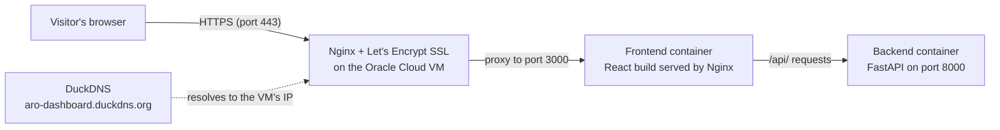

# Deploy Dashboard

A small full-stack app deployed end to end: **Docker, GitHub, a cloud VPS, Nginx and free HTTPS**, built as part of the Social Eagle Gen AI Architect Program.

**Live site:** https://aro-dashboard.duckdns.org

The page shows live data from the backend (container name, Python version, uptime, visit count) and refreshes every 5 seconds, which proves the frontend and backend are talking to each other in production.

## Architecture



## Tech stack

| Layer | Tool |
|---|---|
| Frontend | React (Vite) |
| Backend | FastAPI (Python 3.11) |
| Containers | Docker and Docker Compose |
| Server | Oracle Cloud Always Free VM (Ubuntu 22.04) |
| Reverse proxy | Nginx |
| HTTPS | Let's Encrypt via Certbot (auto-renewing) |
| Domain | DuckDNS (free subdomain) |

## Run it locally

```bash
docker compose up --build
```

Then open http://localhost:3000. Secrets live in `backend/.env`, which is never committed. Copy `backend/.env.example` to `backend/.env` and fill in the values.

## Redeploy loop

```bash
# On the laptop
git add . && git commit -m "Describe the change" && git push

# On the server
cd ~/SE-AI-B12-1-Offline-Assignment
git pull
docker compose up --build -d
```

## Cost

The whole deployment runs on free tiers: Oracle Cloud Always Free, DuckDNS and Let's Encrypt.
## What this project demonstrates

- **Containerisation:** separate Dockerfiles for a React (Vite) frontend, built in a multi-stage build and served by Nginx, and a FastAPI backend, started together with Docker Compose.
- **Environment parity:** the same images run on my laptop and on the cloud server.
- **Secrets hygiene:** `.env` is excluded from Git and from the Docker images, and `.env.example` documents the variables.
- **Cloud deployment:** an Ubuntu VM on Oracle Cloud's Always Free tier, with swap added so a 1 GB machine can build the React app.
- **Networking:** a DNS A record, a host-level Nginx reverse proxy, and Oracle firewall rules opened in both the cloud network and the server's own firewall.
- **HTTPS:** a Let's Encrypt certificate issued by Certbot, HTTP to HTTPS redirect, and automatic renewal.
- **Repeatable releases:** a push-pull-rebuild loop that deploys a change in a few minutes.

## Problems solved along the way

| Problem | Cause | Fix |
|---|---|---|
| Docker Desktop would not start | WSL was missing | Installed WSL, restarted |
| Image build could not download Python | DNS lookup failure | Reset DNS and restarted Docker |
| Built image was missing from the local list | Wrong Docker build driver | Rebuilt with `--load` on the default builder |
| Oracle "out of capacity" for the free ARM machine | Free ARM capacity exhausted in the region | Used the free AMD micro machine and added 4 GB swap |
| Ports 80 and 443 still blocked after opening them | Allow rules were below a REJECT rule | Reordered the iptables rules so they come first |
| SSH sessions dropped | Idle connection timeout | Added keep-alive settings |

## Limitations and next steps

Single small server, no database, no monitoring or backups, and manual deploys. Natural upgrades: a GitHub Actions pipeline that deploys on push, a PostgreSQL container with a persistent volume, uptime monitoring, and SSH hardening (restrict by IP, add fail2ban).