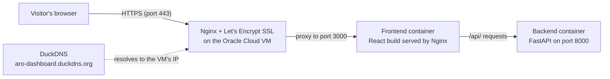

# Deploy Dashboard

A small full-stack app deployed end to end: **Docker, GitHub, a cloud VPS, Nginx and free HTTPS**, built as part of the Social Eagle Gen AI Architect Program.

**Live site:** https://aro-dashboard.duckdns.org

The page shows live data from the backend (container name, Python version, uptime, visit count) and refreshes every 5 seconds, which proves the frontend and backend are talking to each other in production.

## Architecture



## Tech stack

| Layer | Tool |
|---|---|
| Frontend | React (Vite) |
| Backend | FastAPI (Python 3.11) |
| Containers | Docker and Docker Compose |
| Server | Oracle Cloud Always Free VM (Ubuntu 22.04) |
| Reverse proxy | Nginx |
| HTTPS | Let's Encrypt via Certbot (auto-renewing) |
| Domain | DuckDNS (free subdomain) |

## Run it locally

```bash
docker compose up --build
```

Then open http://localhost:3000. Secrets live in `backend/.env`, which is never committed. Copy `backend/.env.example` to `backend/.env` and fill in the values.

## Redeploy loop

```bash
# On the laptop
git add . && git commit -m "Describe the change" && git push

# On the server
cd ~/SE-AI-B12-1-Offline-Assignment
git pull
docker compose up --build -d
```

## Cost

The whole deployment runs on free tiers: Oracle Cloud Always Free, DuckDNS and Let's Encrypt.